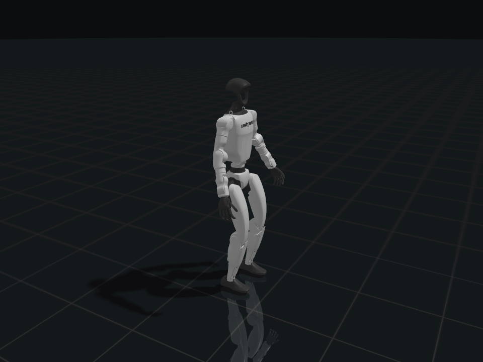

# boltrt

Deploy any policy on MuJoCo or real robots with one C++ loop.



- **Modular observations.** Register plugins and select them in YAML.
- **One binary.** Change `--backend mujoco` to `--backend g1` to select a real robot adapter.
- **Native C++.** MimicLite CPU `policy_ms`: **p50 0.449 ms / max 1.029 ms**; [measurement](docs/performance.md).

## Installation

Linux, CMake 3.22+, C++20. On Ubuntu:

```bash
sudo apt-get install cmake g++ curl libeigen3-dev libyaml-cpp-dev \
  zlib1g-dev libzmq3-dev libglfw3-dev libgl1-mesa-dev
./tools/fetch-deps.sh --sim-only
cmake --preset sim
cmake --build --preset sim --parallel 4
ctest --preset sim
export PATH="$PWD/build/sim:$PATH"
```

Cache the G1 assets once (see [asset setup](docs/usage.md#assets)), then try the
included minimal zero-action test policy:

```bash
boltrt --robot g1 --policy examples/base-policy.yaml --backend mujoco
```

Omitting `--task` runs the generic, motion-independent base loop. To use a trained
tracking export from the shared [checkpoint folder](https://drive.google.com/drive/folders/1lrPyiiy7anyG3P4wHNIQQQlydboLPd9e):

```bash
boltrt --robot g1 --policy policy.yaml --backend mujoco --task tracking
```

Add `--motion motions/walk1_subject1.npz` to track a clip; otherwise tracking uses
a static reference at the default posture. In the terminal, use `I` to initialize,
`]` to enter policy, and `Space` to play/pause the reference. MuJoCo controls
physics independently. The included base test policy is not a trained controller.

## Policies and validation

**BFM-Zero · GRIT · HEFT · HoloMotion · Humanoid-GPT · ScaleBFM · SONIC ·
TeleopIT · TWIST2 · MimicLite.** Original deploy exports remain loadable;
new exports can put ONNX bindings in YAML and need only two files.

Python migration parity was checked on **15 external configurations × 32 ticks**
using identical robot states/reference windows; maximum absolute action difference
was **4.04e-5**. This is adapter parity, not a tracking-quality benchmark.
See [validation and performance](docs/performance.md).

G1 and RP1 hardware backends are **experimental**: compiled and checked with
`--validate`, **not run on physical robots**. CUDA/TensorRT and the complete
tracking benchmark are not supported.

## Robot builds

```bash
sudo apt-get install libfmt-dev libspdlog-dev libboost-dev
./tools/fetch-deps.sh --g1 --rp1
cmake --preset robots
cmake --build --preset robots --parallel 4
ctest --preset robots
```

`BOLTRT_G1` and `BOLTRT_RP1` default to OFF. Enable either independently with
CMake; `BOLTRT_VIEWER=OFF` builds without a native window. CI builds sim-only,
runs CTest, and does not fetch hardware SDKs.

## Teleop and extensions

A separate publisher sends reference motion over ZMQ:

```bash
boltrt --task tracking --robot g1 --policy policy.yaml --backend mujoco \
  --motion tcp://127.0.0.1:5555
```

Robot I/O always stays inline. See [usage and controls](docs/usage.md),
[architecture and plugins](docs/architecture.md), and the
[observation example](examples/custom_observation.cpp).
Register new observations with `ObservationRegistry::add`; implement
`RobotBackend` to add another backend. `TrackingLoop` extends the generic,
motion-independent `PolicyLoop`.

## License

The core is [Apache-2.0](LICENSE). **Enabling `BOLTRT_RP1` links GPL-3.0-only
RoboParty code; distribute that linked binary under GPL-3.0.** RP1 is disabled by
default, and no RP1-enabled prebuilt binaries are published.
Dependencies retain their upstream licenses; see [licensing](docs/licensing.md).

## Acknowledgements

Built on [MuJoCo](https://github.com/google-deepmind/mujoco),
[ONNX Runtime](https://github.com/microsoft/onnxruntime),
[unitree_sdk2](https://github.com/unitreerobotics/unitree_sdk2), and
[roboparty_deploy](https://github.com/Roboparty/roboparty_deploy).
Layout inspiration: mink, mjctrl, mjlab, and obj2mjcf.

Boltrt is a standalone C++ migration from [Python sim2real](https://github.com/EGalahad/sim2real);
the Python repository remains independent and unchanged.
