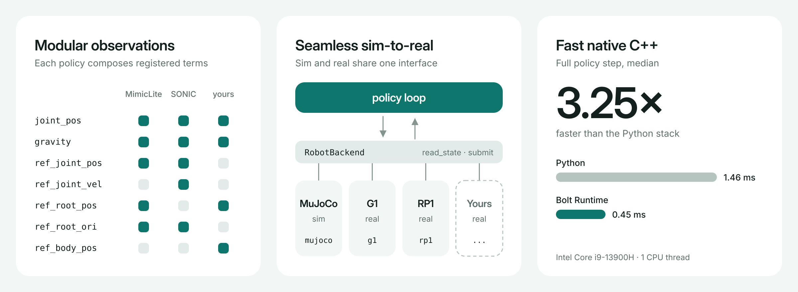

# Bolt Runtime

**Bolt any policy onto any robot.**

[](https://github.com/EGalahad/boltrt/actions/workflows/ci.yml)
[](https://egalahad.github.io/boltrt/)
[](LICENSE)

- **Modular observations**: adapt a new policy by composing registered observation terms in its YAML.
- **Seamless sim-to-real**: MuJoCo and real robots implement one interface, decoupled from the policy, so switching is just `--backend`.
- **Fast**: native C++ runs the full policy step 3.25× faster than the Python stack.



## Quick start (sim2sim)

Linux (x86_64 or aarch64), CMake 3.22+, a C++20 compiler.

```bash
sudo apt-get install cmake g++ curl libeigen3-dev libyaml-cpp-dev \
  zlib1g-dev libzmq3-dev libglfw3-dev libgl1-mesa-dev
./tools/fetch-deps.sh --sim-only
cmake --preset sim && cmake --build --preset sim --parallel
export PATH="$PWD/build/sim:$PATH"
```

Download a checkpoint such as `mimic-lite/v1_1` from the
[checkpoint folder](https://drive.google.com/drive/folders/1lrPyiiy7anyG3P4wHNIQQQlydboLPd9e)
and run it. Robot models are pulled from Hugging Face on first use.

```bash
boltrt --task tracking --robot g1 --backend mujoco \
  --policy mimic-lite/v1_1/policy.yaml \
  --motion motions/walk1_subject1.npz
```

With the terminal focused, press `I` → `]` → `Space` to initialize, enter the
policy and play the motion.

## Supported policies

Original deploy exports load as-is.

| Family | Robot |
|---|---|
| MimicLite | G1, RP1 |
| BFM-Zero · GRIT · HEFT · HoloMotion · Humanoid-GPT | G1 |
| ScaleBFM · SONIC (incl. SMPL input) · TeleopIT · TWIST2 | G1 |

## Extending with a coding agent

The repository ships a `boltrt-extend` skill in [`.agents/skills/`](.agents/skills/boltrt-extend)
(also linked from `.claude/skills/`). Coding agents such as Claude Code and Codex use it to add
robots, policies, observations and backends, with the ownership rules, verification steps and
known pitfalls of this codebase. Ask, for example, "deploy my checkpoint on G1".

## Documentation

[egalahad.github.io/boltrt](https://egalahad.github.io/boltrt/) covers the core
architecture, observations and backends, the tracking task, teleop, real robots
and how to extend Bolt Runtime.

| Status | |
|---|---|
| MuJoCo, CPU ONNX Runtime, ZMQ teleop | ✅ |
| Unitree G1 / RoboParty RP1 backends | 🧪 build and pass `--validate`; not yet run on hardware |
| GPU inference (CUDA / TensorRT) | ❌ |

## License

The core is [Apache-2.0](LICENSE). Building with `BOLTRT_RP1=ON` links
GPL-3.0-only RoboParty code; that binary must be distributed under GPL-3.0.
See [licensing](docs/reference/licensing.md).

## Acknowledgements

Built on [MuJoCo](https://github.com/google-deepmind/mujoco),
[ONNX Runtime](https://github.com/microsoft/onnxruntime),
[unitree_sdk2](https://github.com/unitreerobotics/unitree_sdk2) and
[roboparty_deploy](https://github.com/Roboparty/roboparty_deploy).
Thanks to the authors of every policy listed above.
Bolt Runtime is the C++ successor to the Python [sim2real](https://github.com/EGalahad/sim2real).
