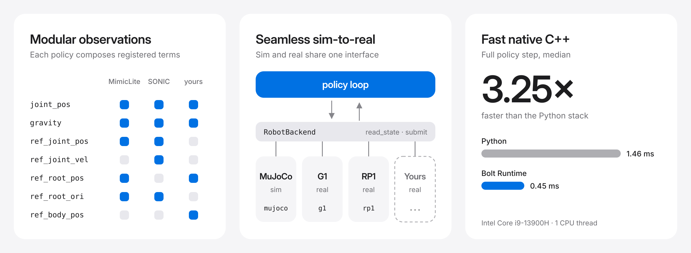

# Bolt Runtime

**Bolt any policy onto any robot.** Bolt Runtime (`boltrt`) is a native C++
deployment runtime for learned robot policies.

- **Modular observations**: adapt a new policy by composing registered observation terms in its YAML.
- **Seamless sim-to-real**: MuJoCo and real robots implement one interface, decoupled from the policy, so switching is just `--backend`.
- **Fast**: native C++ runs the full policy step 3.25× faster than the Python stack.



A run is always the combination of three configurations plus an optional task:

```bash
boltrt --robot g1 --policy policy.yaml --backend mujoco [--task tracking]
```

| Piece | Owns |
|---|---|
| **robot** | joint/body names, MJCF model, dynamics and torque limits |
| **policy** | ONNX model, observations, PD gains, default pose, action scale |
| **backend** | where commands go: MuJoCo, Unitree G1, RoboParty RP1 or a recorded replay |
| **task** | what the loop does around the policy; `tracking` adds reference motion |

## Where to go next

- New here: [Installation](getting-started/installation.md), then [Quick start](getting-started/quickstart.md).
- How the runtime is built: [Core architecture](core/architecture.md).
- Running tracking policies, motions and teleop: [Tracking task](tasks/track/overview.md).
- Deploying on hardware: [Real robots](real-robots.md).
- Adding your own policy, robot or backend: [Extending](extending/add-observation.md).
