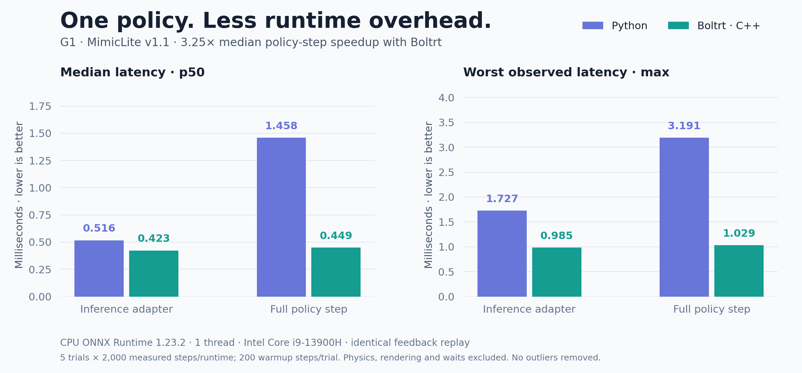

# Performance and validation

## CPU policy-step measurement

On 2026-11-04, G1 + MimicLite v1.1 + `walk1_subject1`, CPU ONNX Runtime
1.23.2, Intel Core i9-13900H, Python 3.10.0, GCC 13.3.0 Release (`-O3`).
Both processes were pinned to CPU 0, with one ORT intra/inter-op thread and
one OMP/MKL/OpenBLAS thread. The native build was sim-only, without a viewer.

| Timed region | Python p50 (ms) | Bolt Runtime p50 (ms) | Python max (ms) | Bolt Runtime max (ms) |
|---|---:|---:|---:|---:|
| Inference adapter | 0.515776 | 0.422953 | 1.727289 | 0.984647 |
| Full policy step | 1.458484 | 0.448937 | 3.190976 | 1.029220 |

The median policy step is **3.25× faster** on this workload. Inference uses
the same CPU ORT implementation in both runtimes; much of the improvement comes
from observation/reference processing and runtime overhead, rather than a new
inference engine. This is not a general speedup claim for every policy.

Five alternating Python/C++ trials each used 200 warmup and 2,000 measured
steps, yielding **10,000 measured samples per runtime**. All measured samples
are retained; p50 is pooled across trials and max is the largest observed sample.
The shared development host was not an isolated real-time test machine; CPU
frequency and scheduling can affect absolute values, especially maxima.

A native headless rollout supplied one fixed robot-feedback stream. Each runtime
replayed it outside the timer and consumed the same checkpoint and motion clip.
Python called the existing `IntegratedPolicyRuntime.step()` implementation;
Bolt Runtime used its replay backend. This measures policy computation, not separate
closed-loop trajectories. The Python checkout was not modified; source hashes
identify its tested working-tree implementation.

- **Full policy step:** reference sampling, observations/history, inference,
  action mapping and command construction/submission. Physics stepping, feedback
  input, rendering, recording, startup and deliberate waits are excluded.
- **Inference adapter:** CPU ONNX Run plus each adapter's binding/copy overhead;
  this is not kernel-only inference latency.

Raw [samples](data/performance-samples.csv), [metadata and hashes](data/performance-results.json),
and [vector chart](../media/performance.svg) are included. Native latency collection
is available with `--timings outputs/latency.csv`; see [usage](cli.md).

## Python migration parity

The frozen 2026-11-02 same-state/reference-window check covered **15 external
configurations × 32 ticks**. Maximum absolute action difference was
**4.035234451293945e-5** (TWIST2). See [per-configuration results](data/parity-results.json).
This validates policy adapters separately from motion decoding or tracking quality.
After the task/namespace restructure, all 15 exports also passed native 32-tick
loading/execution checks.

## Build and integration coverage

A clean local clone built sim-only and G1+RP1 configurations; **11/11 CTest
checks passed in each**. G1 and RP1 passed `--validate` without opening devices.
The clean build completed G1 MimicLite `walk1_subject1` headless playback
(13,065 ticks, no deadline misses). This is a runtime smoke test, not aligned
tracking-quality scoring. PTY terminal controls/restoration and canonical ZMQ
continuity/disconnect checks also passed.

Hardware remains experimental and has not run on physical robots.
CUDA/TensorRT and the complete tracking benchmark remain unsupported.
